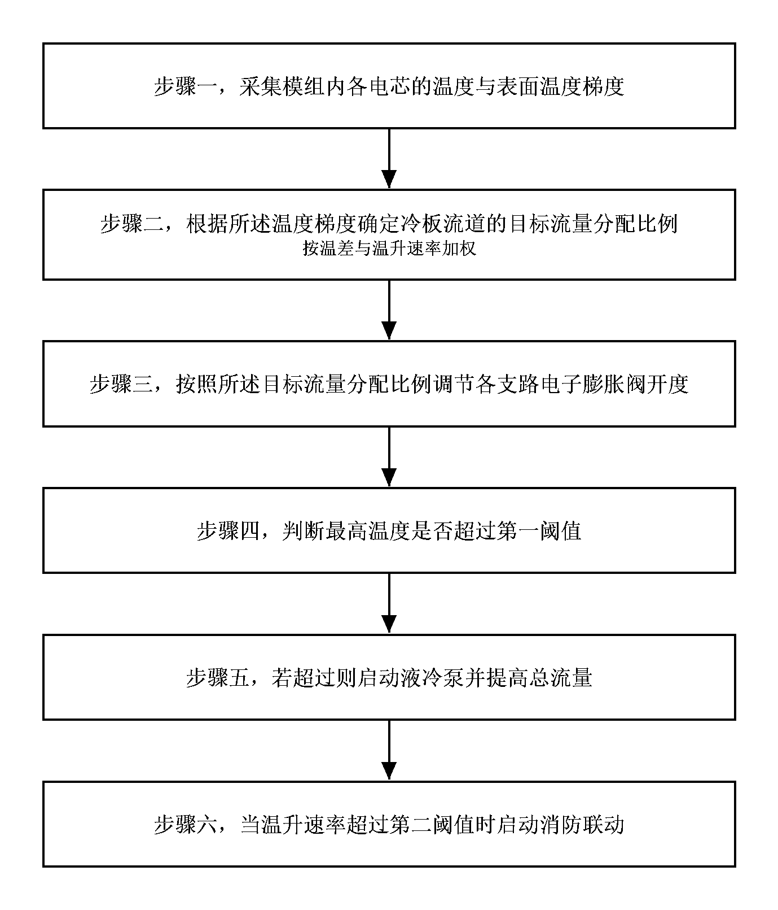
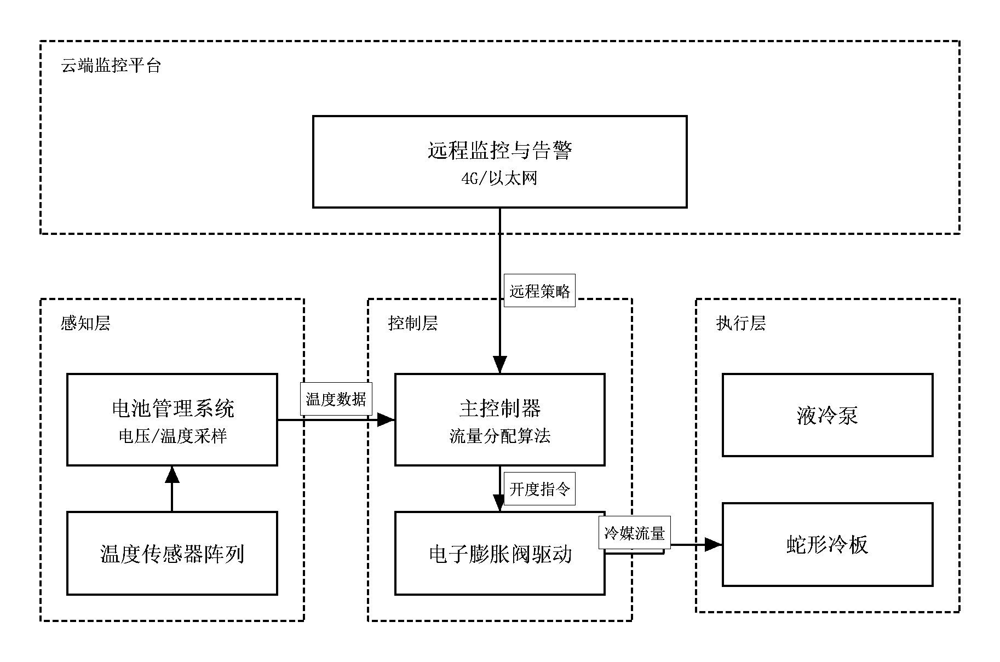
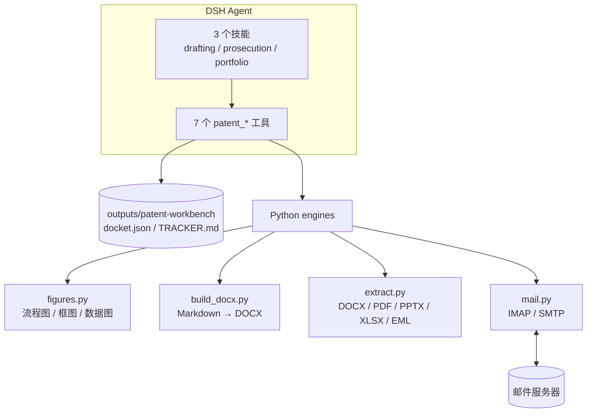

<div align="center">

# 储能专利工作台

**Energy Storage Patent Workbench for DeepSeek Harness**

把储能研发资料变成可递交的中国专利：挖点、交底、权利要求、说明书、黑白附图、案卷台账、审查意见提取与邮箱答复。

[](#安装)
[](#前置条件)
[](LICENSE)
[](#已知限制)

[功能](#功能) · [演示](#演示) · [安装](#安装) · [快速开始](#快速开始) · [工具](#工具) · [技能](#技能) · [架构](#架构) · [配置](#配置) · [限制](#已知限制) · [English](#english-summary)

</div>

---

## 为什么做这个

储能专利有几个很现实的特点：

- **技术碎**：材料、电芯、模组、BMS、PCS、EMS、消防、并网，一个方案经常横跨多个子系统。
- **参数多**：倍率、温差、循环寿命、SOC 窗口、流道尺寸、阈值、采样周期，写少了不支持，写多了泄密。
- **图难画**：方法流程图、系统框图、数据对比图每次都要重画，还要满足黑白、无灰度、图号不进图等要求。
- **答复急**：审查意见、补正、驳回通知经常从邮箱来，期限、对比文件、法条、逐条意见需要先拆清楚。
- **案卷散**：交底、申请、审查、授权、年费分散在文件夹和聊天记录里，下一次盘点靠回忆。

这个插件把上述环节拆成 **7 个工具 + 3 个技能 + 4 个 Python 引擎**，每个环节都有明确的输入、产出和护栏。

## 功能

| 能力 | 你能做什么 | 实现 |
| --- | --- | --- |
| 资料摄入 | 给一个文件夹或单文件（md/txt/docx/pdf/pptx/xlsx/eml），自动抽正文、标题、图片清单、储能领域分支和候选技术表述 | `patent_intake` |
| 专利撰写 | 从资料挖 3–5 个专利点，做轻量查新，写交底书，再直接出权利要求书、说明书、摘要与附图 | `energy-storage-patent-drafting` + `patent_docx` |
| 直接出图 | 方法流程图、系统框图、黑白数据图，直接生成 300dpi 纯黑白 PNG + SVG，自动登记到案件 | `patent_figure` |
| 权利要求校验 | 编号、引用、多项从属、引用基础、宣传语、步骤编号的机械检查 | `patent_claim_check` |
| 案卷维护 | 建案、改状态、记事件、算答复/年费期限、生成 `TRACKER.md`、月度盘点 | `patent_case` + `energy-storage-patent-portfolio` |
| 审查答复 | 从通知书或审查员邮件提取申请号、发文日、对比文件、法条、逐条意见与期限，起草意见陈述 Word | `patent_oa_extract` + `energy-storage-patent-prosecution` |
| 邮箱办理 | IMAP 看信/读附件，SMTP 生成 `.eml` 草稿；发送必须显式确认 | `patent_mail` |

## 演示

下面是插件实际生成的专利附图，不是设计稿：

| 方法流程图（`flow`） | 系统框图（`block`） |
| --- | --- |
|  |  |

案卷台账由工具生成，可直接放进项目或月报：

```markdown
# 专利案卷台账

| 案件号 | 名称 | 类型 | 状态 | 申请号 | 审查员 | 下一期限 |
| --- | --- | --- | --- | --- | --- | --- |
| es-demo-001 | 储能电池模组液冷热管理方法及系统 | 发明 | 内部复核 | — | — | — |
| es-demo-oa | 储能电池模组液冷热管理方法（审查演示） | 发明 | 审查中 | 202610123456.7 | 李四 | 2027-03-04（115天） |

期限为按规则估算的提醒，不替代国知局通知书与代理机构期限管理。
```

> 演示数据为合成样例，仅用于展示工作流，不构成任何真实的申请或法律意见。

## 安装

### 前置条件

| 依赖 | 是否必需 | 说明 |
| --- | --- | --- |
| DeepSeek Harness（DSH） | 必需 | 需要 `plugin_manager` 工具；本项目是 DSH 插件，不是独立应用 |
| Python 3.10+ | 必需 | 用于 Word、附图、资料抽取与邮件引擎 |
| `python-docx` | 必需 | 生成 `.docx` |
| `Pillow` | 必需 | 生成 PNG 附图、文字测量 |
| `pdftotext`（Poppler） | 可选 | 从 PDF 抽取文字；扫描件仍需 OCR |
| IMAP/SMTP 账号 | 可选 | 只有使用 `patent_mail` 时需要 |

安装 Python 依赖：

```bash
python -m pip install python-docx Pillow
```

`pdftotext` 安装方式：

- Windows：安装 [Poppler for Windows](https://github.com/oschwartz10612/poppler-windows/releases)，把 `bin` 加入 PATH。
- macOS：`brew install poppler`
- Ubuntu/Debian：`sudo apt install poppler-utils`

如果 DSH 使用自带 Python 运行时，通常已包含 `python-docx` 与 `Pillow`，可以不额外安装。

### 安装到 DSH

1. 克隆或下载本仓库到本地：

   ```bash
   git clone https://github.com/Horizonepn/dsh-energy-patent.git
   cd dsh-energy-patent
   ```

2. 在 DSH 会话里让 Agent 安装这个目录（使用绝对路径）：

   > 把 `<absolute-path>/dsh-energy-patent` 安装为 DSH 插件。

   对应的工具调用是：

   ```
   plugin_manager action=install_bundle
   target=<absolute-path>/dsh-energy-patent
   ```

   `install_bundle` 会写入当前 profile 的 `package.json` 并启用 bundle。**不要手工修改** profile 的 `package.json` 或 `cordis.patch.yml`。

3. 安装结果里确认：

   ```json
   { "application": "applied", "enabled": true }
   ```

4. 用 `plugin_manager action=list_plugins` 确认：

   | 字段 | 期望值 |
   | --- | --- |
   | `entryId` | `include:energy-patent` |
   | `enabled` | `true` |
   | `fiberPhase` | `active` |

5. 打开 **Settings → Plugins**，应看到「储能专利工作台 / Energy storage patent workbench」；在会话里应能看到 7 个 `patent_*` 工具和 3 个 `energy-storage-patent-*` 技能。

### 更新与卸载

- **更新**：替换仓库文件后，在 DSH 里把 `include:energy-patent` 禁用再启用一次，或重新执行 `install_bundle`。只改 `skills/`、`locale/` 也需要重载才会重新读取。
- **卸载**：`plugin_manager action=remove_bundle target=@local/energy-patent`。
- **目录链接**：`install_bundle` 通常以链接方式安装本地目录，源目录被移动或删除会导致插件失效。分享给他人时请打包整个仓库，在目标机器重新安装。

### 当前仓库的包名

`package.json` 里的 `name` 是 `@local/energy-patent`，表示“本地插件”。本仓库**不是 npm 公共包**，不需要 `npm install`；安装入口始终是 DSH 的 `plugin_manager`。

## 快速开始

在 DSH 会话里直接说：

```text
用 examples/储能模组液冷方案.md 写一篇储能专利，发明类型。
```

Agent 会依次调用 `patent_intake`、加载 `energy-storage-patent-drafting` 技能、生成交底与申请文件，并在需要时调用 `patent_figure` 和 `patent_docx`。

更多常用说法：

| 目标 | 说法 |
| --- | --- |
| 资料摄入 | “先读一下我给的资料目录，建一个储能专利案卷。” |
| 交底书 | “基于这份资料挖 3 个专利点，选一个写成交底书。” |
| 申请文件 | “把交底改成权利要求书、说明书、摘要和附图。” |
| 出图 | “把权利要求 1 的步骤画成专利流程图，黑白线稿。” |
| 权要校验 | “检查这份权利要求书的引用关系和引用基础。” |
| 审查意见 | “从这份审查意见通知书提取逐条意见和答复期限。” |
| 邮箱 | “看看专利邮箱最近有没有审查员来信，生成回复草稿。” |
| 台账 | “把 90 天内到期的专利列出来，并更新台账。” |

## 工具

### `patent_intake` — 资料摄入

读取文件夹或单文件，抽取正文、标题、图片清单、储能领域分支与候选技术表述，建立案件并写 `materials/digest.md`。

主要参数：`path`（必填）、`caseId`、`title`、`patentType`、`maxFiles`、`maxChars`、`focus`。

### `patent_case` — 案卷台账

支持 `create / list / get / update / event / deadlines / tracker / archive`。每次更新都写事件；`tracker` 重新生成 `TRACKER.md`。

期限规则（可配置）：

| 事项 | 默认规则 |
| --- | --- |
| 审查意见答复 | 发文日 + 15 日推定送达 + 4 个月（发明）/ 2 个月（实用新型、外观） |
| 年费 | 申请日周年 |
| 优先权 | 申请日起 12 个月 |

### `patent_figure` — 直接出图

支持三种图型，输出 300dpi 纯黑白 PNG + SVG：

| `kind` | 用途 | 关键字段 |
| --- | --- | --- |
| `flow` | 方法流程图 | `steps[].label`、`steps[].detail`、`start`、`end` |
| `block` | 系统/装置框图 | `columns[].title`、`columns[].nodes[]`、`links[]`、`extras[]` |
| `chart` | 黑白数据图 | `chartType`、`categories`、`series[]`、`xLabel`、`yLabel` |

示例：

```json
{
  "kind": "flow",
  "spec": {
    "steps": [
      { "label": "步骤一，采集模组内各电芯的温度与表面温度梯度" },
      { "label": "步骤二，根据温度梯度与温升速率确定各支路目标流量分配比例" },
      { "label": "步骤三，按照目标流量分配比例调节电子膨胀阀开度" }
    ]
  }
}
```

### `patent_docx` — 排版 Word

把 Markdown 排成 CNIPA 风格 Word：A4、25mm 页边距、宋体小四、1.5 倍行距、标题黑体、首行缩进、页脚页码。

| `kind` | 输入 | 输出 |
| --- | --- | --- |
| `disclosure` | 交底 Markdown | 交底书 `.docx` |
| `application` | 目录中的 `权利要求书.md`、`说明书.md`、`说明书摘要.md`、`figures/*.png` | 四件套 `.docx` |
| `opinion` | 意见陈述 Markdown | 意见陈述 `.docx` |

### `patent_oa_extract` — 审查意见提取

从 PDF / DOCX / TXT / EML 提取：

- 申请号、发明名称、发文日、审查员、通知书类型
- 对比文件（D1/D2、公开号）
- 法条与缺陷类型（新颖性、创造性、清楚/支持、充分公开、超范围、单一性、必要技术特征等）
- 逐条审查意见与原文关键句
- 答复期限（规则估算，以通知书为准）

结果落盘为 `notice.json`、`notice.md`、`答复工作清单.md`，并把案件转入 `oa` 状态。

### `patent_mail` — 邮箱办理

| `action` | 作用 |
| --- | --- |
| `status` | 检查配置，不连接服务器 |
| `inbox` | 列最近邮件，可按主题/发件人/摘要过滤 |
| `read` | 读正文与附件，使用 BODY.PEEK，不标记已读 |
| `draft` | 生成回复 `.eml`，自动带 `In-Reply-To` / `References` |
| `send` | 发送，必须显式 `confirm="SEND"` |

### `patent_claim_check` — 权利要求校验

检查编号连续性、独立/从属引用、多项从属引用多项从属、`所述…` 引用基础、宣传语、`步骤一/二…` 编号。只做形式检查，不评价新颖性、创造性或授权前景。

## 技能

插件注册 3 个可被 Agent 加载的技能：

| 技能 | 何时加载 | 产出 |
| --- | --- | --- |
| `energy-storage-patent-drafting` | 写专利、交底、申请文件、专利挖掘 | 交底书、权利要求书、说明书、摘要、附图、Word |
| `energy-storage-patent-prosecution` | 审查意见、OA、补正、驳回、回复审查员 | 提取结果、答复策略、意见陈述、回信草稿 |
| `energy-storage-patent-portfolio` | 专利台账、期限、年费、月度盘点、1+N 布局 | 台账、期限雷达、盘点报告 |

技能里包含储能领域的技术分支、IPC/CPC 提示、常见审查风险、附图规范与写作护栏。

## 架构



数据流：

1. `patent_intake` 读取资料，写 `materials/digest.json` 与 `digest.md`。
2. Agent 按技能挖点、查新、撰写，把 Markdown 写到案件 `drafts/`。
3. `patent_figure` 生成 `figures/*.png|svg`。
4. `patent_docx` 读取 Markdown 与图片，生成 `drafts/<时间戳>/*.docx`。
5. `patent_case` 记录状态、事件与期限，生成 `TRACKER.md`。
6. `patent_oa_extract` 与 `patent_mail` 负责审查阶段的收文、提取与回信。

## 数据目录

默认写在当前工作区，所有路径都集中在 `outputs/patent-workbench/`：

```text
outputs/patent-workbench/
├── docket.json                    # 唯一台账
├── TRACKER.md                     # 自动生成
├── cases/
│   └── <caseId>/
│       ├── materials/
│       │   ├── digest.md
│       │   └── digest.json
│       ├── drafts/
│       │   ├── application/
│       │   │   ├── 权利要求书.md
│       │   │   ├── 说明书.md
│       │   │   ├── 说明书摘要.md
│       │   │   └── figures/
│       │   └── <YYYYMMDD-HHmmss>/
│       │       ├── 权利要求书.docx
│       │       ├── 说明书.docx
│       │       ├── 说明书摘要.docx
│       │       └── 说明书附图.docx
│       ├── figures/
│       │   ├── fig1.png
│       │   ├── fig1.svg
│       │   └── ...
│       ├── oa/
│       │   └── <YYYYMMDD-HHmmss>/
│       │       ├── notice.md
│       │       ├── notice.json
│       │       └── 答复工作清单.md
│       └── mail/
│           └── drafts/*.eml
└── mail/
    ├── drafts/
    └── attachments/
```

`docket.json` 是唯一事实来源；`TRACKER.md` 由工具生成，不要手工改。建议把 `outputs/` 排除在 Git 之外（本仓库 `.gitignore` 已默认忽略）。

## 配置

### 期限规则

工作区根目录可放 `patent-workbench.config.json`：

```json
{
  "responseMonths": { "invention": 4, "utility": 2, "design": 2 },
  "serviceDays": 15,
  "annuityWarningDays": 60,
  "mailConfigPaths": ["patent-mail.config.json"]
}
```

| 字段 | 含义 |
| --- | --- |
| `responseMonths` | 审查意见答复月数 |
| `serviceDays` | 推定送达天数 |
| `annuityWarningDays` | 年费提前提醒天数 |
| `mailConfigPaths` | 邮箱配置搜索路径，相对工作区或绝对路径 |

### 邮箱

在工作区根目录创建 `patent-mail.config.json`，或放到 `~/.dsh/patent-mail.config.json`：

```json
{
  "imap": {
    "host": "imap.example.com",
    "port": 993,
    "secure": true,
    "user": "ip@example.com",
    "passwordEnv": "PATENT_MAIL_PASSWORD",
    "mailbox": "INBOX"
  },
  "smtp": {
    "host": "smtp.example.com",
    "port": 465,
    "secure": true,
    "user": "ip@example.com",
    "passwordEnv": "PATENT_MAIL_PASSWORD"
  },
  "fromName": "知识产权部",
  "signature": "知识产权部\n某储能科技有限公司"
}
```

- 密码可以写 `password`，也可以用 `passwordEnv` 指向环境变量。推荐后者或应用专用授权码。
- 不要把邮箱配置、真实邮件、客户资料提交到 Git。
- 发送前务必先 `draft`，人工复核后再 `send`。

### 环境变量

| 变量 | 作用 |
| --- | --- |
| `PATENT_PYTHON` | 指定 Python 解释器 |
| `DSH_PYTHON` | 同上，兼容 DSH 环境 |
| `PATENT_MAIL_PASSWORD` | 邮箱密码/授权码，配合 `passwordEnv` 使用 |

Python 查找顺序：`PATENT_PYTHON` / `DSH_PYTHON` → `$DSH_HOME/dsh-runtimes/*/dependencies/python/python.exe` → `py -3` → `python`。

## 设计边界

- **工具只做机械工作**：抽取、校验、排版、出图、台账、邮件传输。技术事实、权利要求文字、答复策略由 Agent 按技能撰写，须发明人/代理师复核。
- **不编造事实**：对比文件、公开号、实验数据、审查员姓名不得编造；查新使用 `web_search` / `web_fetch`，并给出可核验来源。
- **期限是估算**：发文日 + 15 日推定送达 + 4/2 个月、申请日周年，都不替代国知局通知书、缴费通知与代理机构期限管理。
- **附图有边界**：自动生成只覆盖方法流程、系统框图和黑白数据图；剖视、爆炸、多状态结构图需要用户提供 CAD/线稿/照片，由 `patent_docx` 嵌入。
- **邮件有闸门**：读取使用 BODY.PEEK，不批量标记已读；发送必须显式 `confirm="SEND"`。
- **不做官方递交**：不生成国知局电子申请 XML/CPC 包，不生成请求书、费减、序列表、TIFF，也不代替代理师签字。

## 已知限制

| 限制 | 说明 |
| --- | --- |
| Word 公式 | Markdown 中的 LaTeX 目前按纯文本写入，不转 OMML；需要可编辑公式时请人工处理 |
| 图型 | 只支持 `flow` / `block` / `chart`；结构剖视、爆炸、多状态图需外部素材 |
| PDF | 依赖文字层；扫描件需要 OCR，工具会提示 `extracted_text_too_short` |
| 邮箱 | 只支持密码认证的 IMAP/SMTP，不支持 OAuth2；企业邮箱请用应用专用密码 |
| 提取准确率 | `patent_oa_extract` 与 `patent_claim_check` 是启发式辅助，必须对照原文复核 |
| 平台 | 主要在 Windows + DSH Desktop 验证；Linux/macOS 需自行确认中文字体与 `pdftotext` |
| 界面 | 当前是 Host 工具 + 技能，没有独立 Web 仪表盘页面 |
| 版本 | v0.1.0 alpha，工具参数与数据结构可能调整 |

## 开发

```text
.
├── index.js                 # Host 插件：注册技能与工具
├── cordis.patch.yml         # DSH bundle patch
├── lib/
│   ├── tools/               # 7 个工具定义
│   ├── store.js             # 案卷、期限、TRACKER
│   ├── oa.js                # 通知书解析
│   ├── domain.js            # 储能领域词表与 IPC 提示
│   ├── figures.js           # 附图工具封装
│   ├── docx.js              # Word 工具封装
│   ├── intake.js            # 资料摄入
│   ├── mail.js              # 邮箱工具封装
│   └── python.js            # Python 引擎启动器
├── engine/
│   ├── figures.py           # PNG/SVG 附图
│   ├── build_docx.py        # Markdown → DOCX
│   ├── extract.py           # DOCX/PDF/PPTX/XLSX/EML 文本抽取
│   └── mail.py              # IMAP/SMTP
├── skills/                  # 3 个 SKILL.md
├── locale/                  # en/zh 显示元数据
├── docs/assets/             # README 图片
└── icon.svg
```

四个 Python 引擎都可以独立运行（调试时有用）：

```bash
python engine/figures.py --input spec.json --out-dir out
python engine/build_docx.py --input spec.json
python engine/extract.py --input spec.json
python engine/mail.py --config mail.json --action status --input -
```

其中 `figures.py`、`build_docx.py`、`extract.py` 从 stdin 或 `--input <file>` 读 JSON；`mail.py` 需要 `--config` 与 `--action`。

## 发布到 GitHub

建议把 **`energy-patent-plugin/` 目录本身**作为仓库根目录上传，而不是把整个工作区（含 `outputs/`、原始 skill 压缩包、真实资料）一起上传。

发布前检查：

```bash
git init
git add .
git status          # 确认没有 outputs/、*.eml、patent-mail.config.json、真实客户资料
git commit -m "feat: energy storage patent workbench"
git branch -M main
git remote add origin <your-repo-url>
git push -u origin main
```

- `.gitignore` 已默认排除 `outputs/`、`__pycache__/`、`*.eml`、`patent-mail.config.json`。
- `docs/assets/` 只放 README 用的合成示例图；不要放客户图纸或未公开结构。
- 仓库名建议 `dsh-energy-patent`；Topics 可填 `dsh-plugin`、`patent`、`energy-storage`、`cnipa`、`python-docx`。
- 如果仓库根目录不是插件目录，安装时 `plugin_manager target` 要指向插件子目录，而不是仓库根。

## 相关项目

本插件与团队内部的 **`patent-dev` 自办撰写流水线**并行使用，不合并代码：

- `patent-dev`：Python 3.13 CLI，负责 `case.yaml` → Markdown / DOCX / XML / 国知局案卷包结构件，强调自办与 PR 评审。
- 本插件：DSH Host 插件，负责资料摄入、储能领域撰写、黑白附图直出、审查意见提取与邮箱草稿。
- 两者通过文件衔接：本插件生成的附图可复制到 `patent-dev` 的 `cases/<id>/figures/`，由 `drawings.figures[].file` 引用；案件事实仍以 `case.yaml` 为准。

## 安全与隐私

- 默认本地运行：资料、附图、Word、台账都写在工作区；只有 `patent_mail` 会访问邮件服务器。
- 邮箱密码建议用 `passwordEnv`，不要写进配置文件或 Git。
- `patent_mail` 的输出不会包含密码；发送必须显式确认。
- 真实专利材料、客户名称、未公开实验数据不要提交到公开仓库；提 Issue 时请脱敏。
- 建议定期备份 `outputs/patent-workbench/docket.json` 与 `cases/`。


